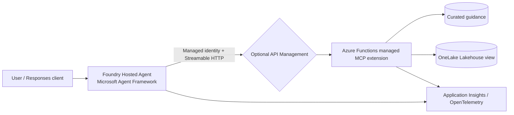

# Foundry Hosted Agent + Remote MCP Demo

This sample shows how an enterprise can expose governed knowledge, Lakehouse
business data, and approval-gated capabilities to a Microsoft Foundry Hosted
Agent through the Azure Functions managed MCP extension. HWC implements tool
logic while Azure Functions owns the MCP endpoint, discovery, protocol
lifecycle, hosting, and scaling. The business source is a curated summary view
in the configured enterprise Lakehouse. Nothing sends
email, calls a production system, or performs an irreversible action.

## Architecture



The production-shaped path uses Microsoft Agent Framework, the Responses 2.0
host, `gpt-5-mini`, and Azure Functions managed MCP tool triggers.

## Components

* **Hosted agent** (`agent/main.py`): Microsoft Agent Framework agent exposed
  through the Responses 2.0 protocol.
* **Local test double** (`agent/agent.py`, `agent/server.py`): fast scripted
  behavior for deterministic tests; it is not the deployed agent.
* **Managed remote MCP server** (`mcp-server/`): Azure Functions
  `mcpToolTrigger` functions. The Functions MCP extension owns Streamable HTTP,
  tool discovery, protocol lifecycle, and endpoint scaling.
* **Governed business data** (`shared/data.py`): the MCP business lookup can
  consume validated rows from the configured OneLake-backed summary view.
  Synthetic data remains the local fallback when `HWC_DATA_SOURCE=synthetic`.
* **Governed approvals** (`fabric/approval_notebook.py`): a parameterized
  Fabric notebook validates explicit decisions and appends them to the
  `action_approvals` Delta table with approver and UTC audit fields.
* **Observability**: F5 exports agent spans to Foundry Toolkit on port 4317.
  Azure Functions supplies platform logs and Application Insights integration
  for the MCP runtime. The deployed hosted agent disables Agent Framework
  instrumentation so prompts, completions, tool arguments, and tool results are
  not written to session logs; HTTP status and Function platform telemetry remain
  available. No telemetry resource is provisioned by this repository's local
  workflow.

## Prerequisites

* Python 3.13
* Azure Functions Core Tools 4.0.7030 or later
* Azure Developer CLI with the Microsoft Foundry extension
* Access to a configured Microsoft Foundry project and `gpt-5-mini` deployment
* Microsoft Entra credentials available through `DefaultAzureCredential`
* Microsoft ODBC Driver 18 for SQL Server when `HWC_DATA_SOURCE=fabric`
* x64 Windows or Linux when running the local Azure Functions Python worker;
  ARM64 hosts use the native MCP compatibility server described below

## Local setup and demo

```powershell
Set-Location C:\workspace\hosted-agent-mcp\foundry-hosted-agent-mcp-demo
Copy-Item agent\.env.example agent\.env
Copy-Item mcp-server\local.settings.json.example mcp-server\local.settings.json
agent\.venv\Scripts\python.exe -m pip install -r agent\requirements.txt
agent\.venv\Scripts\python.exe -m pip install -r mcp-server\requirements.txt
```

Confirm the values in `agent/.env` and `mcp-server/local.settings.json`, then press `F5` and select **Debug HWC
Hosted Agent**. VS Code starts the managed Functions MCP endpoint at
`http://127.0.0.1:8001/runtime/webhooks/mcp`, starts the Responses host on port
8088, attaches the debugger, and opens Foundry Toolkit Agent
Inspector and Trace Viewer. Use the first demo prompt, then select the agent
and MCP spans in Trace Viewer to show model, tool, latency, and correlation
metadata without exposing prompt or completion content.

For the scripted test-double harness instead:

```powershell
agent\.venv\Scripts\python.exe scripts\start_local.py
```

### ARM64 and Docker handoff

The current ARM64 Windows/WSL development path does **not** use Docker. The
Azure Functions MCP runtime image and its Python worker are x64. Running that
image on ARM64 through Docker's amd64/QEMU emulation caused the Python worker
to exit and left the MCP endpoint returning HTTP 503.

Use the native FastMCP compatibility server on ARM64. It exposes the same
tools at the same Streamable HTTP URL and delegates to the same business logic
as the Azure Functions implementation. Azure Functions remains the production
deployment transport. Docker remains suitable on an x64 development host or
as part of an approved x64 deployment workflow.

From PowerShell on the ARM64 Windows host:

```powershell
$env:USE_LOCAL_MCP = "1"
agent\.venv\Scripts\python.exe scripts\start_local.py
```

The equivalent commands from WSL are:

```bash
export USE_LOCAL_MCP=1
./agent/.venv-wsl/bin/python scripts/start_local.py
```

The launcher loads the repository root `.env`. Keep `HWC_DATA_SOURCE=fabric`
and the Fabric SQL endpoint, database, schema, and summary-view coordinates in
that file to use the governed OneLake data. Set `HWC_DATA_SOURCE=synthetic`
only when an offline fallback is intentionally required.

On Windows, install the Fabric SQL driver from an elevated terminal if it is
not already available:

```powershell
winget install --id Microsoft.msodbcsql.18 --exact
```

### Demo script

Start with this briefing prompt:

> Summarize the current position for the demo entity HWC-1001. Identify the
> primary exception and show your sources.

Expected result: the agent calls `get_business_summary` and
`search_hwc_knowledge`, identifies the overdue reconciliation exception, and
returns source IDs `SYN-OPS-001` and `SYN-POL-001`.

Then use this proposal prompt:

> Prepare a follow-up action for the demo entity HWC-1001 addressing the
> primary exception. Do not execute it without approval.

Expected result: the agent calls `get_business_summary` and
`prepare_follow_up_action`, returns `PENDING_APPROVAL`, and reports that
explicit human approval is required. Enter the approver identity in the UI and
use **Approve** or **Reject** to record the decision through the Fabric
notebook. No generic field-update endpoint is exposed.

### Demo frontend

With the MCP server running on port 8001, start the customer-facing demo UI
from the repository root:

```powershell
$env:MCP_SERVER_URL = "http://127.0.0.1:8001/runtime/webhooks/mcp"
agent\.venv\Scripts\python.exe frontend\server.py
```

Open `http://127.0.0.1:5173`. The UI presents the exception briefing, source
identifiers, invoked MCP tools, and the proposal-only approval boundary. It
uses the deterministic Responses test double for presentation while all
business and knowledge retrieval still runs through the configured MCP
endpoint (native FastMCP on ARM64 or managed Azure Functions on x64).

Approval decisions use `FABRIC_APPROVAL_NOTEBOOK_ID`. The frontend submits an
explicit `APPROVED` or `REJECTED` decision, waits for the Fabric notebook job,
and displays its audit ID. The notebook verifies the exception exists before
appending to `action_approvals`; it never updates the SQL analytics endpoint.

## Vendor Contract Assurance

**Current hosted status:** all four agent roles are registered and active in
Foundry: original HWC v6, assurance orchestrator v8, and Contract/RFP analysts
v5. All three acceptance turns have verified execution receipts. On
2026-10-29 at 14:55-14:58 UTC, the complete hosted conversation passed using
Responses 2.0. Original HWC v6 is unchanged.
MCP publishing succeeded at 13:04 UTC; all six triggers are indexed
and both specialists performed authenticated retrieval.

**PR #5 follow-up:** five review fixes now pass 49 focused tests and a
corrected-code, real-model local browser demo (including reset and stale
continuation recovery). Those fixes have not been redeployed to Azure because
explicit redeployment approval was unavailable; v8/v5/v5 remains the earlier
verified hosted baseline. Details are in the
[deployment record](deployment/contract-assurance/README.md).

The verifier checked three discrepancies, matching EU residency, all eight
citations, exact generated-document read/annotation lineage, and reused RFP
context on the service-credit follow-up. Existing Application Insights contains
94 metadata-only spans, including four linked comparison/handoff trace trees,
eight successful specialist authorizations and eight successful MCP retrievals.
No prompts, document bytes, bearer tokens, or model completions were exported
by the manual trace path.

Earlier discovery failures were resolved with the separately approved
project-scoped invocation grant. Hosted A2A execution was unsupported; the
user-approved Responses migration preserves the specialist executor, model,
caller validation, MCP allowlist, and document contract. Foundry ingress
credential forwarding was corrected without weakening JWT checks or networking.
See the [deployment record](deployment/contract-assurance/README.md) for approvals,
endpoints, trace IDs, and verification limits, and the
[requirements audit](docs/contract-assurance-audit.md) for coverage.
See [private Copilot Studio connectivity](docs/copilot-studio-private-connectivity.md)
for the Activity requirement, A2A/custom connector alternatives, and firewall limits.

This separate, **read-only** demo uses three real model-backed services:
a Responses-hosted orchestrator delegates over **Responses 2.0 HTTP** to a
Contract Analyst and an RFP Analyst. Each specialist has its own Agent Framework
session and one allowlisted MCP retrieval tool. The existing HWC demo, Fabric
configuration, authentication, and approval workflow are unchanged. The new page
never calls the deterministic `HostedAgent` mock or the approval endpoint.

Northstar Cloud Services is fictional. Its seeded terms are **demo terms, not
customer facts**, contractual interpretation, or legal advice:

| Topic | RFP commitment | Contract clause | Result |
| --- | --- | --- | --- |
| Uptime | 99.95% | 99.5% | Discrepancy |
| Service credit | 10% | 5% | Discrepancy |
| Breach notification | 24 hours | 72 hours | Discrepancy |
| Data residency | EU | EU | Match |

Stable source IDs are `DEMO-NS-RFP-001` through `004` and
`DEMO-NS-CON-001` through `004`, respectively, in table order. Both MCP
transports expose `retrieve_contract_clauses` and `retrieve_rfp_commitments`.
Missing vendor/topic evidence returns no clauses; specialists must abstain.
Comparison uses only evidence returned by the remote specialists, not a local
analyst substitute. No tools modify contracts, Fabric records, or approvals.

### Setup and live client

Use the existing project endpoint and model deployment in the root `.env`.
Local runs incur model usage, but do not provision resources, deploy agents,
create connections, or change infrastructure:

```powershell
agent\.venv\Scripts\python.exe -m pip install -r agent\requirements-contract-assurance.txt
$env:CONTRACT_ASSURANCE_TRACE = "1"  # Optional; omit for no trace output
agent\.venv\Scripts\python.exe scripts\start_contract_assurance.py
```

Open `http://127.0.0.1:5173/contract-assurance.html`. The launcher starts a native
MCP server if port 8001 is free, Responses specialists on 8091/8092, the real Responses
orchestrator on 8090, and the frontend on 5173. Existing MCP/frontend processes
are retained; an existing MCP must be restarted to discover the two new tools.
An existing frontend must be restarted with `CONTRACT_ASSURANCE_LOCAL=1` and
`CONTRACT_ORCHESTRATOR_BASE_URL=http://127.0.0.1:8090/`. Stop the launcher with
Ctrl+C to stop only its own child processes. It does not launch `agent.server`.

The verified local Responses route is `/responses`, not `/v1/responses`.
The browser sends an opaque application session ID; raw response IDs remain
server-side, mapped to an HttpOnly, SameSite browser-owner cookie. This frontend
is a loopback-only demo, not a multi-user authenticated production gateway.
Assurance API requests require a loopback Host on the actual listening port
before session creation or forwarding; matching arbitrary Host/Origin headers
are not trusted. If a hosted call has an unresolved outcome (including a lost
first response), the gateway blocks further calls and reset rather than falsely
claiming remote histories were cleared. A fresh browser review is separate from
an acknowledged reset of the abandoned review.

Send these prompts **in the same conversation**, in order:

1. "Compare this vendor's contract with its RFP commitments."
2. "Generate synthetic findings, then have the RFP Analyst read and validate the document."
3. "What did they promise instead for service credits?"

Expect three discrepancies and matching EU residency, with both document IDs
cited for each comparison. The follow-ups should resolve to 10% promised versus
5% contracted, citing `DEMO-NS-RFP-002` and `DEMO-NS-CON-002`.
**Reset conversation** invokes the real orchestrator's reset tool for both
specialists, then discards the parent continuation. A new review starts fresh.

The revised UI shows execution-derived session tags, reuse, document versions,
and read/annotation receipts. A model's assertion of success without a tool receipt
is shown as unverified. Findings are actual inline file bytes in the structured
specialist Responses payload, with a preserved
artifact ID, incrementing annotation version, parent digest, and source citations.

The CLI checks **hosted** integration only. First configure the observed Foundry
endpoints, three distinct agent names and deployed versions in the `.env.example`
fields; all three base URLs end with `/protocols/openai/`. Specialist definitions
must declare Responses 2.0 before running the updated verifier; old A2A-only
versions do not qualify. Existing permissions and private
connectivity must already be authorized. Then, only in that environment:

```powershell
$env:CONTRACT_ASSURANCE_LOCAL = "0"
agent\.venv\Scripts\python.exe scripts\verify_contract_assurance.py --live
```

Without explicit authorization and remote configuration it reports **NOT RUN**.
It reads actual hosted version definitions before invoking the three prompts,
and checks term/citation results, execution-derived gap/residency counts,
document read/version receipts and the same reused RFP context tag. It reports
safe receipts only, not conversation content. Offline
tests use fake analysts and an in-process SDK transport; they are **not proof of
live hosted execution**. Model-backed local verification is also not verification of deployed
Foundry endpoints, managed identities, platform routing, or hosted persistence.

For F5 debugging, run the launcher with `--without-orchestrator`, then select
**Debug Vendor Contract Assurance**. The original HWC F5 configuration remains
available. Use the assurance page for the three-service live path.

### Sessions, Authentication, and Traces

Specialist continuation is keyed by trusted caller, parent `AgentSession`, and
specialist. The specialist executor retains its own session keyed by authenticated
principal and application `contextId`. Calls to the same specialist session are
serialized; different callers/parents/specialists do not share context.
The parent Responses host resumes through `previous_response_id`; the remote
specialists use server-owned `previous_response_id` continuations for Responses
routing and carry their application `contextId` in the structured request.
The Responses adapter invokes the existing executor directly, not another model
to reinterpret commands or fabricate receipts. Each input is processed once;
previous transcripts are not replayed into the executor.
Storage is in memory and single-process; restarts lose context and now require an
explicit reset. Unknown/expired state is never silently recreated as reused.
Specialist history and cached replies are evicted after 30 minutes of inactivity/
request age, with periodic maintenance and a 1,024-entry cap on each registry.
Cleanup protects active calls and queued retries. Timestamped operation IDs let
expired requests fail closed after their cached content has been deleted;
retries must retain the original ID. Specialist resets omit transport continuations
so an expired stored Responses record cannot prevent an application-context reset.
Logical request IDs deduplicate successful retries; failed calls roll back history,
and ambiguous calls block different input until retry or reset. Do not treat
context IDs or trace tags as credentials. Reset clears active context, not a
durable retention/audit record.

Local anonymous access requires explicit `CONTRACT_ASSURANCE_LOCAL=1` and is
restricted to loopback. Outside local mode, outgoing requests use
`DefaultAzureCredential` with `https://ai.azure.com/.default` (or an explicitly
configured scope) and HTTPS only. Specialist ingress validates signed Entra JWTs
against `CONTRACT_ASSURANCE_TENANT_ID` and `CONTRACT_ASSURANCE_AUDIENCE`, including
issuer, tenant, audience, and expiry. The orchestrator requires the trusted user
identity supplied by Foundry; caller IDs from prompts are never accepted.
Directly exposing the container with spoofable platform headers is not supported.
Foundry consumes the gateway Authorization header, so the client also sends the
same signed bearer in `x-client-assurance-authorization`, using the SDK's
`x-client-` pass-through contract. The specialist validates that credential with
the existing JWT verifier and caller allowlist, then removes both credential
headers before the Responses host sees the request. Credentials are never placed
in stored Responses input, metadata, or application telemetry.
The existing MCP token/audience configuration is reused, with refreshed tokens
on MCP connections. Hosted ingress, identity permissions, and Responses protocol
registration must be verified before an approved deployment; none are changed here.

Tracing is off by default. With `CONTRACT_ASSURANCE_TRACE=1`, stderr contains
one-line `assurance.call` JSON records with an allowlist of role, trace/span IDs,
parent span, hashed session tag, reuse boolean, elapsed time, and success.
SDK logging and automatic hosting exporters are disabled on this extension.
Prompts, completions, clauses, tool arguments/results, tokens, raw caller IDs,
and raw session IDs are never emitted by this trace path. Do not turn on HTTP
body/debug logging or broad GenAI instrumentation alongside this demo.

For each comparison, verify linked `orchestrator.compare`, `delegate.contract`,
`delegate.rfp`, `specialist.contract`, `specialist.rfp`, and `mcp.retrieve`
events share a trace ID. Delegate/specialist session tags stay stable and
`session_reused` becomes `true` on both follow-ups; after reset it is `false`.
Use only these metadata records as trace evidence, not the model's claim that
it remembered a conversation.

### Verified SDK and Protocol References

The opt-in dependency file pins the locally checked versions: Agent Framework
core 1.15.0, Foundry 1.11.0, hosting 1.0.0b260821, OpenAI 2.54.0, and official
`a2a-sdk` 1.2.3. Hosted specialists now use the installed
`ResponsesAgentServerHost` and `TextResponse` APIs. The A2A SDK remains for
internal typed message/file models and the separately tested local A2A adapter;
it is not the hosted wire protocol. Foundry card discovery can succeed while
its A2A gateway rejects hosted invocation. See
[the deployment record](deployment/contract-assurance/README.md).

References checked against installed signatures and implementation:
[Foundry hosted protocols/authentication](https://learn.microsoft.com/en-us/azure/ai-foundry/agents/concepts/hosted-agents),
[Agent Framework session isolation](https://learn.microsoft.com/en-us/agent-framework/agents/conversations/session),
[A2A hosting](https://learn.microsoft.com/en-us/agent-framework/integrations/a2a),
[A2A 0.3 specification](https://a2a-protocol.org/v0.3.0/specification/).

### Verification Record

**Hosted, 2026-10-29:** all three unchanged acceptance turns passed against
orchestrator v8 / Contract v5 / RFP v5. Actual execution receipts verify the
comparison, exact document lineage/read receipt, and stable reused RFP session.
Application Insights confirms four linked business trace trees through delegates,
specialists, MCP retrieval, and artifact handoff. All 39 focused regression,
transport, and privacy tests pass. See the
[deployment record](deployment/contract-assurance/README.md) for trace IDs.
This verifies the tested hosted conversation, not durable state across restarts
or an authenticated multi-user frontend.

**Historical, before the document-handoff audit changes:** verified locally on
2026-10-28 with the existing Foundry model: all three live
acceptance prompts passed the CLI term/citation checks, including three
discrepancies and matching EU residency. Real A2A HTTP metadata showed both
specialists retaining stable session tags and reuse on both follow-ups. The
browser live flow and reset also completed; desktop/mobile checks found no
horizontal overflow. No deterministic mock was used for this live evidence.

Offline: 14 assurance tests passed (comparison, citations, missing evidence,
transport parity, reuse, isolation, concurrency, reset, browser ownership,
JWT validation, and trace privacy). The complete suite reported **30 passed,
1 failed**. The pre-existing `test_agent_handles_summary_without_risks` failure
returns `[]` for the action mock while the existing agent expects an action
dictionary; the extension does not alter that unrelated behavior. JavaScript
syntax, Python compilation, and whitespace checks passed.

Outstanding: no Azure deployment was performed. Foundry-hosted A2A protocol
registration, endpoint routing, managed-identity permissions, and authenticated
multi-user hosted invocation have **not** been verified. A2A 0.3 preview and
the pinned SDK's deprecation warnings remain compatibility constraints. The
local session stores are not durable or cross-process production stores.

## OneLake configuration

The governed business source uses these configured Fabric objects:

* Workspace: `<fabric-workspace-name>`
* Workspace ID: `<fabric-workspace-id>`
* Lakehouse: `<fabric-lakehouse-name>`
* Lakehouse ID: `<fabric-lakehouse-id>`
* Table: `dbo.<source-table-name>`
* Summary view: `dbo.<summary-view-name>`
* Approval notebook: `<fabric-approval-notebook-id>`

Provide the environment-specific coordinates in `.env` and
`mcp-server/local.settings.json` using the committed examples. Copy the latter
to `mcp-server/local.settings.json` before starting the Functions host. The
local file is ignored by Git because it is the place for runtime secrets and
local overrides.

The identity used to run the host needs read access to the Fabric Lakehouse and
permission to run the configured notebook. Provisioning or updating the
notebook requires Fabric workspace Contributor and `Notebook.ReadWrite.All` or
`Item.ReadWrite.All`. OneLake DFS access uses a Microsoft Entra token for
`https://storage.azure.com/`. A quick connectivity check lists the governed
schema at:

```text
https://onelake.dfs.fabric.microsoft.com/<workspace-id>/<lakehouse-id>/Tables/dbo
```

The expected entries are the configured source table and summary view. Read
access uses that source; approval writes are isolated in the append-only
`action_approvals` table and require an explicit approver identity.

## Tests

```powershell
agent\.venv\Scripts\python.exe -m unittest discover -s tests -v
```

Tests cover managed MCP trigger registration, validation, empty results,
missing entities, approval behavior, and deterministic demo
evaluations. See [evaluation.md](evaluation.md),
[docs/architecture.md](docs/architecture.md), and [docs/poc-plan.md](docs/poc-plan.md).

## Azure deployment (approval required)

Deployment is not part of local setup. Before any deployment, complete the
resource, identity, networking, observability, SKU, and cost sections in
`.azure/deployment-plan.md`; run Azure validation; review the resulting plan;
and obtain explicit approval. The managed MCP endpoint must be deployed and its
URL configured before deploying the hosted agent because a hosted agent cannot
reach `127.0.0.1`. The deployed path is `/runtime/webhooks/mcp`. The MCP
service's `prepackage` hook stages both the Function source and shared synthetic
data under `.azure/mcp-server`.

Cleanup: first list resources with `az resource list --resource-group
<resource-group> -o table`, confirm the list with the owner, then run
`azd down` only after explicit approval. This repository never deletes Azure
resources automatically.

### Deployment networking note

The project Storage Account may have `publicNetworkAccess: Disabled` because
of an effective organization policy. This is an operational deployment note,
not a limitation of the application. If package upload is unavailable from the
developer machine, use the approved private build path with access to the
Storage private endpoint, or the organization-approved policy exception route.
The Function App's managed identity and data-plane roles remain unchanged.

## Security model and limitations

Microsoft Entra authentication must be enforced at the deployed Functions
ingress, with managed identity and least-privilege RBAC used between services.
The MCP extension webhook is anonymous because platform Easy Auth owns that
boundary; do not deploy it publicly without Easy Auth. The sample approval UI
accepts an approver identifier for demonstration; production must derive that
identity from authenticated claims rather than trusting free-text input.

## Troubleshooting

* `Connection refused`: run `func start --port 8001` from `mcp-server`.
* MCP initialization failure: verify Core Tools is 4.0.7030 or later and
  `MCP_SERVER_URL` ends with `/runtime/webhooks/mcp`.
* `The Azure Functions Python worker does not support windows-arm64`: do not
  run the Functions host directly on Windows ARM64. Use an x64 Windows/Linux
  host or a supported x64 container host. On an ARM64 WSL distribution,
  installing Python 3.13 in a virtualenv is not enough: Core Tools still
  launches its bundled `linux-arm64` Python worker, which cannot load the
  MCP-capable Python 3.13 dependencies.
* `FunctionApp object has no attribute mcp_tool`: install the dependencies
  from `mcp-server/requirements.txt`. The managed MCP decorators require
  `azure-functions==2.3.0`, Python 3.13, and the current Azure Functions Core
  Tools runtime. Keep this version pinned; older 1.x releases do not provide
  the `mcp_tool` decorator.
* `Secret initialization from Blob storage failed`: for local development,
  set `AzureWebJobsSecretStorageType` to `Files` in
  `mcp-server/local.settings.json`. This avoids requiring Azurite or an Azure
  Storage connection just to start the local host.
* `No module named shared` when starting from `mcp-server`: include the repo
  root on `PYTHONPATH`:

  ```bash
  cd mcp-server
  PYTHONPATH=.. func start --port 8001
  ```

  On a Linux or WSL host, install dependencies once before starting:

  ```bash
  python3.13 -m venv .venv-wsl
  .venv-wsl/bin/python -m pip install -r mcp-server/requirements.txt
  ```

* Remote `401`: verify Easy Auth configuration and the agent managed-identity
  token audience.
* Stale demo state: restart the MCP server.
