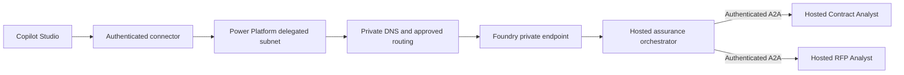

# Copilot Studio to Private Foundry Agents

Architecture guidance only. No networking, endpoint registration, consent,
permission, or deployment operation was performed. Tenant-specific connectivity
and authentication are **UNVERIFIED**.

## Supported Paths

1. **Native Foundry connected agent (preview):** Microsoft's current connector
   documentation requires an **Activity** endpoint; Responses/A2A alone is not
   sufficient and can fail with HTTP 400. It supports agents from the new Foundry
   experience, not the previous portal's agents. This repo's orchestrator exposes
   Responses only, so native connector integration is **BLOCKED** pending an
   approved Activity configuration and validation. Nothing enables it here.
2. **A2A connection:** Copilot Studio documents OAuth 2.0 authentication and use
   of custom-connector infrastructure for A2A agents in VNets/on-premises. That
   path must reach a compatible A2A message endpoint and discovery card. This
  repo uses A2A 1.0 JSON-RPC for its specialists, but its orchestrator is not an
   A2A server. Connecting directly to a specialist would bypass orchestration;
   an orchestrator A2A adapter is a future prerequisite, not implemented proof.
3. **Private custom connector/HTTP API:** Power Platform VNet support documents
   private outbound connectivity for custom connectors and HTTP with Microsoft
   Entra ID. An approved connector can call the orchestrator's existing
   non-streaming Responses endpoint, or an organization-approved authenticated
   API adapter can preserve server-owned conversations. This is ordinary HTTP
   invoking Responses, **not standardized A2A**. Endpoint/schema compatibility,
   response-size limits, timeouts, user identity mapping, and error handling
   require tenant-specific tests. No API adapter or network service is deployed.

## Prerequisites and Controls

- An eligible Power Platform environment, subscription association, enterprise
  policy, and dedicated subnet delegation. Follow the documented regional
  mapping, environment eligibility, and IP-capacity requirements. Trial and
  Dataverse for Teams environments are not supported by the VNet overview.
- Approved Foundry private endpoints, private DNS resolution from the **connector
  runtime**, routing/peering as needed, and HTTPS/443 permitted by existing NSGs
  and firewalls. A developer VPN working does not prove that the connector runtime
  can connect. Keep public network access and existing firewall controls intact.
- Foundry outbound private routing for agents to reach specialists and MCP, with
  DNS and any required project-level capability-host configuration verified for
  the chosen deployment model. Do not equate private inbound access with private
  agent egress. This repo does not provision capability hosts or change networks.
- Entra OAuth tokens with the actual resource audience, required existing Foundry
  invocation rights, and consent appropriate to the connector. Agent identities
  need their own existing downstream rights. Network access does not confer
  authorization. Never place tokens, API keys, or SAS credentials in artifact
  references or URLs. A hash is an integrity check, not an access token.
- End-user/tenant identity must be validated and mapped to app-owned sessions.
  The local browser cookie gateway is not a production authenticated BFF or an
  OBO implementation. Don't trust caller IDs from prompts or unvalidated headers.
- DLP policies, licensing, connector availability, TLS trust, and preview-feature
  acceptance must be reviewed by the tenant owner. The native connector's Activity
  prerequisite and the A2A connector's transport/version behavior must be tested.

## Limitations and Unverified Assumptions

Power Platform VNet support controls supported **outbound** connector traffic; it
does not make the entire Copilot Studio runtime part of the Foundry VNet. An
on-premises or VNet data gateway is not a blanket replacement for that support.
Default connected-agent behavior does not prove source citations, file handoff,
or conversation ownership survive every hop. Preserve and test them explicitly.
The current A2A 0.3 adapter's compatibility with the deployed Foundry ingress,
card URL rewriting, bearer-header delivery, and sandbox routing is unverified.

Do not solve a failed test by allowing anonymous access, publishing a dev tunnel,
turning public network access on, or broadly allowlisting service IPs. Public
sample tunnels and body-logging examples in tutorials are not this architecture.
Metadata-only delegation/session/artifact receipts are the observability boundary.

## Official References

- [Connect a Foundry agent: Activity prerequisite and preview limitations](https://learn.microsoft.com/en-us/microsoft-copilot-studio/add-agent-foundry-agent)
- [Copilot Studio A2A: authentication and private custom-connector infrastructure](https://learn.microsoft.com/en-us/microsoft-copilot-studio/add-agent-agent-to-agent)
- [Power Platform VNet: supported connectors, environments, regions, and delegation](https://learn.microsoft.com/en-us/power-platform/admin/vnet-support-overview)
- [Foundry Private Link: inbound/egress distinction, DNS, and tool limitations](https://learn.microsoft.com/en-us/azure/ai-foundry/how-to/configure-private-link)
- [Foundry hosted protocols, identities, and sessions](https://learn.microsoft.com/en-us/azure/ai-foundry/agents/concepts/hosted-agents)

Reviewed against current official pages on 2026-10-28. Documentation support is
not tenant-specific live verification.